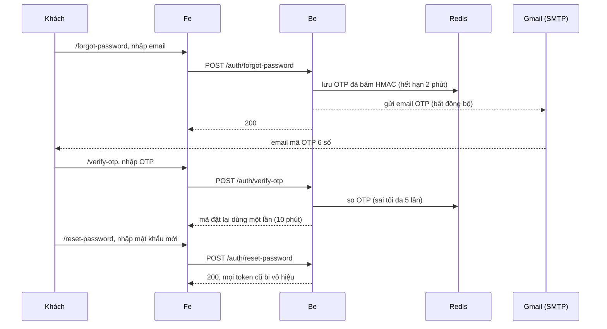
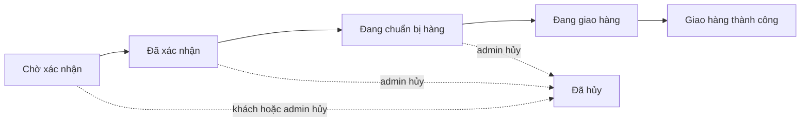
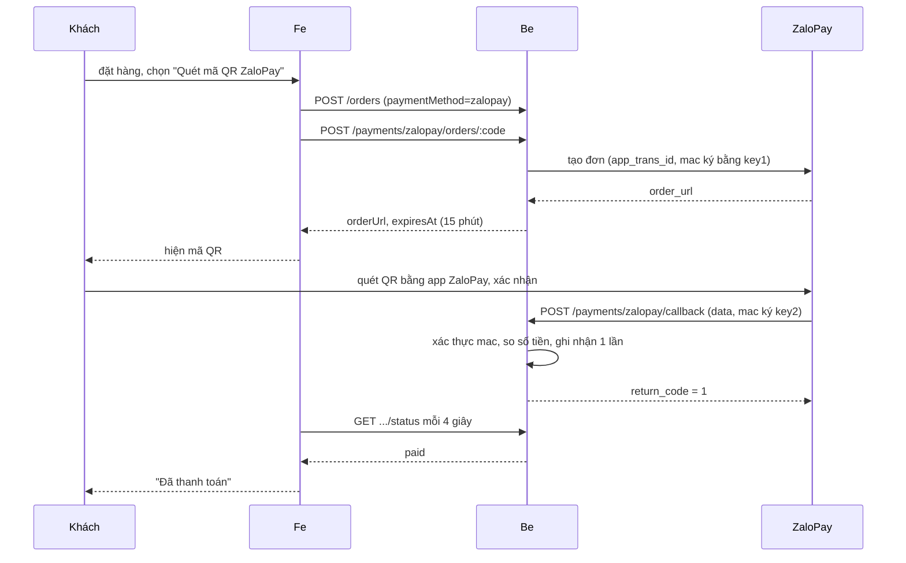

# Lumière Gems: website thương mại điện tử trang sức đá quý

Website bán trang sức đá quý gồm **giao diện khách hàng**, **khu vực quản trị (admin)** và **API**. Khách duyệt sản phẩm, đặt hàng, thanh toán (COD, chuyển khoản hoặc quét mã QR ZaloPay), theo dõi đơn và đánh giá. Admin quản lý sản phẩm, đơn hàng, khuyến mại, nội dung và xem thống kê.

- Frontend: `jewelry-shop/fe` (Next.js)
- Backend: `jewelry-shop/be` (NestJS)
- Cơ sở dữ liệu: MySQL 8 (đang dùng Aiven). Bộ nhớ đệm và OTP: Redis (Docker).

> Tên thương hiệu "Lumière Gems" là giá trị mặc định, admin đổi được trong **Cài đặt → Thông tin cửa hàng**.

---

## Mục lục

1. [Tính năng](#1-tính-năng)
2. [Công nghệ sử dụng](#2-công-nghệ-sử-dụng)
3. [Cấu trúc dự án và quy ước](#3-cấu-trúc-dự-án-và-quy-ước)
4. [Cài đặt và chạy](#4-cài-đặt-và-chạy)
5. [Biến môi trường](#5-biến-môi-trường)
6. [Luồng hoạt động chi tiết](#6-luồng-hoạt-động-chi-tiết)
7. [Hướng dẫn sử dụng theo bước](#7-hướng-dẫn-sử-dụng-theo-bước)
8. [Thanh toán ZaloPay và nhận callback](#8-thanh-toán-zalopay-và-nhận-callback)
9. [Kiểm thử, lint, build](#9-kiểm-thử-lint-build)
10. [Xử lý sự cố thường gặp](#10-xử-lý-sự-cố-thường-gặp)
11. [Lưu ý bảo mật và khi triển khai thật](#11-lưu-ý-bảo-mật-và-khi-triển-khai-thật)

---

## 1. Tính năng

**Khách hàng**
- Xem trang chủ (banner, danh mục, sản phẩm mới/bán chạy/giảm giá/nổi bật, bộ sưu tập, cẩm nang), tìm kiếm, lọc theo loại, giá, chất liệu, loại đá, đối tượng, bộ sưu tập, khuyến mại, còn hàng; sắp xếp.
- Trang chi tiết sản phẩm: thư viện ảnh, chọn size, thông số, đá quý, đánh giá, sản phẩm liên quan.
- Đăng ký, đăng nhập (bằng số điện thoại), quên mật khẩu bằng OTP qua email, đổi mật khẩu.
- Giỏ hàng, yêu thích, sổ địa chỉ (tỉnh/thành và phường/xã sau sáp nhập 2025).
- Đặt hàng, chọn vận chuyển và thanh toán (**COD, chuyển khoản, ZaloPay quét QR**), theo dõi và hủy đơn, đánh giá sản phẩm đã nhận.
- Cẩm nang (bài viết), trang chính sách, hỏi đáp, chatbot trả lời theo từ khóa.

**Quản trị (admin)**
- Tổng quan: doanh thu theo ngày/tháng/năm, đơn theo trạng thái, sản phẩm bán chạy, tồn kho thấp, khách mua nhiều.
- Đơn hàng: tìm kiếm, lọc, chuyển trạng thái từng bước, xác nhận thanh toán chuyển khoản, in hóa đơn.
- Sản phẩm (ảnh, biến thể/size, đá quý), danh mục, chất liệu, loại đá, bộ sưu tập, khuyến mại theo sản phẩm.
- Người dùng (khóa/mở khóa, đổi quyền), đánh giá (ẩn/hiện).
- Nội dung: bài viết, trang nội dung, hỏi đáp, banner, menu (đầu/chân trang), vận chuyển, cài đặt cửa hàng và thông tin chuyển khoản.
- Email tự động: OTP đặt lại mật khẩu; báo **tất cả admin** khi có đơn ZaloPay đã thanh toán; báo **khách** khi đơn giao thành công.

---

## 2. Công nghệ sử dụng

| Lớp | Công nghệ |
|---|---|
| Frontend | **Next.js 16** (App Router, `cacheComponents`), **React 19**, **TypeScript**, **Tailwind CSS 4**, axios, SweetAlert2, react-markdown + remark-gfm, qrcode.react |
| Phông chữ | Lora (Google Fonts, nạp bằng `next/font`) |
| Backend | **NestJS 12**, **TypeScript**, **TypeORM**, class-validator / class-transformer, `@nestjs/jwt`, bcryptjs, multer |
| Cơ sở dữ liệu | **MySQL 8** (driver `mysql2`), kết nối SSL. Bảng và khóa ngoại tạo bằng file SQL riêng |
| Cache, OTP, chống đặt trùng | **Redis 7** (chạy bằng Docker Compose) |
| Lưu ảnh | **Cloudinary** |
| Email | **Nodemailer** qua SMTP (Gmail) |
| Thanh toán | **ZaloPay** (môi trường sandbox) |
| Nhận callback khi chạy local | **Cloudflare Tunnel** (`cloudflared`) |
| Kiểm thử | **Vitest** (be và fe), supertest (e2e be), Testing Library + jsdom (fe) |
| Lint | oxlint (be), ESLint 9 (fe) |

---

## 3. Cấu trúc dự án và quy ước

```
.
├── README.md
├── document/                       Tài liệu yêu cầu nghiệp vụ (.docx)
└── jewelry-shop/
    ├── docker-compose.yml          Redis
    ├── be/                         NestJS
    │   ├── database/               SQL: 01_create_tables, 02_add_foreign_keys, changes/00x_*.sql
    │   ├── scripts/                seed:* (địa chỉ, admin, dữ liệu mẫu, nội dung)
    │   ├── certs/                  ca.pem của DB (không đưa lên git)
    │   ├── src/
    │   │   ├── main.ts, app.setup.ts, app.module.ts
    │   │   ├── aspects/            AOP: @PublishAfter và kênh sự kiện nghiệp vụ
    │   │   ├── config/, decorators/, exceptions/, guards/, middlewares/, models/, utils/
    │   │   └── modules/<domain>/   controllers/, services/, repositories/, models/ (entity), dtos/
    │   └── test/                   test e2e
    └── fe/                         Next.js
        └── src/
            ├── app/                Trang (App Router): (shop), admin, user, cart, checkout, login...
            ├── components/         UI theo nhóm: ui, layout, product, home, orders, admin...
            ├── layouts/, guards/, hooks/, services/, store/, utils/, constants/, types/
```

**Quy ước bắt buộc của backend**
- Kiến trúc 3 lớp: **Controller** chỉ nhận/trả request; **Service** chứa nghiệp vụ; **Repository** chỉ truy vấn dữ liệu. Mỗi domain là một module.
- **Entity chỉ khai báo cột**, không dùng decorator quan hệ của ORM (`@OneToMany`, `@ManyToOne`...) để tránh N+1 query. Cần dữ liệu liên quan thì repository viết truy vấn rõ ràng (JOIN hoặc `IN (...)`).
- **Be không tự tạo bảng** (`synchronize: false`). Bảng và khóa ngoại nằm trong `be/database/`. Thay đổi cấu trúc: sửa `01` và `02`, và thêm một file `changes/00x_*.sql` cho DB đã có dữ liệu.
- Tác vụ phụ (gửi email...) không viết lẫn trong nghiệp vụ mà chạy bất đồng bộ qua **aspect** (xem mục 6.9).
- Mã lỗi chuẩn: `400` dữ liệu sai, `401` chưa đăng nhập/hết hạn, `403` không đủ quyền, `404` không thấy, `409` xung đột trạng thái, `429` quá giới hạn, `500` lỗi hệ thống.

**Quy ước frontend**
- Token đăng nhập lưu ở **`sessionStorage`** (khóa `accessToken`), hết hạn sau 1 ngày. Không lưu ở `localStorage`.
- axios interceptor gắn token và xử lý `401` (về trang đăng nhập) và `403` (trang không có quyền).
- Route private dùng guard (`RouteGuard`); phân quyền theo vai trò `admin` và `user`.
- Giao diện responsive (điện thoại, máy tính bảng, máy tính). Tìm kiếm dùng debounce 500 ms.
- Giao diện dùng biến CSS trong `fe/src/app/globals.css` (màu xanh ngọc và kem), đổi giao diện chỉ cần sửa file này.

---

## 4. Cài đặt và chạy

### 4.1 Yêu cầu

| Công cụ | Ghi chú |
|---|---|
| **Node.js LTS** (20 trở lên, đã chạy được trên 24) và npm | Cần cho cả `be` và `fe` |
| **Docker Desktop** | Chạy Redis |
| Git | Lấy mã nguồn |
| Một **cơ sở dữ liệu MySQL 8** | Hiện dùng Aiven (có SSL). Có thể tự dựng MySQL local |
| Tài khoản **Cloudinary** | Lưu ảnh sản phẩm/banner (không có thì upload ảnh không dùng được) |
| Tài khoản Gmail có **mật khẩu ứng dụng** | Gửi email (không có thì OTP và email thông báo không gửi được) |

### 4.2 Các bước

```bash
# 1. Lấy mã nguồn
git clone https://github.com/letu26/remote.git
cd remote/jewelry-shop

# 2. Redis (cần mở Docker Desktop trước)
docker compose up -d

# 3. Backend
cd be
npm ci
# Tạo file be/.env theo mục 5, rồi chạy:
npm run start          # hoặc npm run start:dev để tự nạp lại khi sửa code

# 4. Frontend (cửa sổ terminal khác)
cd ../fe
npm ci
# Tạo file fe/.env nếu cần đổi địa chỉ API (mục 5)
npm run dev
```

Mở **http://localhost:3000**. API chạy ở **http://localhost:4000/api**.

> Khi dùng `npm run start`, be **không tự nạp lại** khi sửa code, phải chạy lại. Khi sửa `.env` cũng phải khởi động lại be.

### 4.3 Chuẩn bị cơ sở dữ liệu (lần đầu)

1. Tạo database rỗng (mặc định tên `jewelry-shop-db`, bộ ký tự `utf8mb4`).
2. Chạy lần lượt các file SQL trong `be/database/`:
   1. `01_create_tables.sql` (bảng và chỉ mục)
   2. `02_add_foreign_keys.sql` (khóa ngoại)
   
   Hai file này đã gồm cả các thay đổi trong `changes/`. Thư mục `changes/` chỉ dùng để nâng cấp một DB cũ: chạy các file `00x` chưa áp dụng theo thứ tự.
3. Nạp dữ liệu nền (chạy trong thư mục `be`):

```bash
npm run seed:locations                                   # tỉnh/thành và phường/xã
npm run seed:admin -- <số_điện_thoại> <email> <mật_khẩu> # tạo (hoặc nâng cấp) tài khoản admin
npm run seed:cms                                         # bài viết, trang nội dung, hỏi đáp, menu chân trang, thông tin cửa hàng mẫu
npm run seed:shop                                        # phương thức vận chuyển và thông tin chuyển khoản MẪU
npm run seed:catalog                                     # (tùy chọn) sản phẩm mẫu mã DEMO-xxx; thêm -- --remove để gỡ
```

Số điện thoại gồm 10 số bắt đầu bằng 0. Mật khẩu tối thiểu 6 ký tự (nên đặt mạnh hơn).

### 4.4 Chuyển sang máy khác

Ngoài mã nguồn, cần chép riêng (không có trong git): `be/.env`, `fe/.env`, thư mục `be/certs/` (chứa `ca.pem`). Sau đó làm lại mục 4.2. Nếu có dùng đường hầm Cloudflare thì xem mục 8.4.

---

## 5. Biến môi trường

Không đưa file `.env` lên git (đã nằm trong `.gitignore`).

### Backend: `be/.env`

| Biến | Ý nghĩa |
|---|---|
| `PORT` | Cổng be, mặc định 4000 |
| `FRONTEND_URL` | Địa chỉ fe, dùng cho CORS và đường dẫn trong email. Ví dụ `http://localhost:3000` |
| `TRUST_PROXY` | Số proxy tin cậy phía trước be (0 nếu chạy trực tiếp) |
| `DB_HOST`, `DB_PORT`, `DB_USER`, `DB_PASSWORD`, `DB_NAME` | Kết nối MySQL |
| `DB_SSL` | `true` nếu DB yêu cầu SSL |
| `DB_SSL_CA` | Đường dẫn file chứng chỉ CA, ví dụ `./certs/ca.pem`. Bỏ trống (hoặc để chú thích) thì mã hóa nhưng **không xác thực** máy chủ |
| `REDIS_URL` | Ví dụ `redis://:<mật_khẩu>@localhost:6379`. Mật khẩu mặc định trong `docker-compose.yml` có thể đổi bằng biến `REDIS_PASSWORD` |
| `JWT_SECRET`, `JWT_EXPIRES_IN` | Khóa ký token (đặt chuỗi dài, ngẫu nhiên) và thời hạn (`1d`) |
| `OTP_SECRET` | Khóa băm OTP |
| `OTP_TTL_SECONDS` (120), `OTP_MAX_ATTEMPTS` (5), `OTP_RESEND_COOLDOWN_SECONDS` (60), `RESET_TICKET_TTL_SECONDS` (600) | Quy tắc OTP |
| `MAIL_HOST`, `MAIL_PORT`, `MAIL_USER`, `MAIL_PASSWORD`, `MAIL_FROM` | SMTP. Với Gmail: `smtp.gmail.com`, cổng 587, `MAIL_PASSWORD` là **mật khẩu ứng dụng** 16 ký tự (không phải mật khẩu đăng nhập) |
| `CLOUDINARY_URL`, `CLOUDINARY_FOLDER` | `cloudinary://<api_key>:<api_secret>@<cloud_name>` và thư mục gốc, mặc định `jewelry-shop` |
| `ZLP_APP_ID`, `ZLP_KEY1`, `ZLP_KEY2` | Thông tin ứng dụng ZaloPay |
| `ZLP_ENDPOINT` | Mặc định `https://sb-openapi.zalopay.vn/v2/` (sandbox) |
| `ZLP_CALLBACK_URL` | Địa chỉ công khai của `POST /api/payments/zalopay/callback`. Để trống khi chưa có đường hầm |
| `ZLP_REDIRECT_URL` | (Tùy chọn) trang chuyển khách về sau khi trả trong app |

### Frontend: `fe/.env`

| Biến | Ý nghĩa |
|---|---|
| `NEXT_PUBLIC_API_URL` | Địa chỉ API. Mặc định `http://localhost:4000/api` |

---

## 6. Luồng hoạt động chi tiết

### 6.1 Đăng ký, đăng nhập, phiên làm việc

1. **Đăng ký** (`POST /api/auth/register`): họ tên, email, số điện thoại, mật khẩu. Email và số điện thoại không được trùng (`409`). Mật khẩu được băm bằng bcrypt trước khi lưu. Vai trò mặc định `user`.
2. **Đăng nhập** (`POST /api/auth/login`) bằng **số điện thoại** và mật khẩu. Thành công trả JWT chứa `id`, `email`, `role`, hạn 1 ngày. Tài khoản bị khóa thì không đăng nhập được.
3. Fe lưu token ở `sessionStorage`, điều hướng theo vai trò: `admin` → `/admin`, `user` → `/user`. Hỗ trợ `?redirect=` (chỉ đường dẫn nội bộ) để quay lại trang cần đăng nhập.
4. Mỗi request kèm `Authorization: Bearer <token>`. Be kiểm tra chữ ký, hạn, **tài khoản còn hoạt động**, và token có trong **blacklist** (bảng `token_blacklist`) hay không.
5. **Đăng xuất** (`POST /api/auth/logout`): đưa token hiện tại vào blacklist. **Đổi hoặc đặt lại mật khẩu** thì mọi token cũ của tài khoản bị vô hiệu.
6. Token hết hạn hoặc sai → `401`, fe xóa token và đưa về trang đăng nhập.

### 6.2 Quên mật khẩu bằng OTP



- OTP 6 số lưu ở Redis dạng **băm HMAC**, hết hạn **2 phút**. Sai tối đa **5 lần**. Gửi lại cách nhau **60 giây**.
- OTP đúng thì be cấp một mã đặt lại **dùng một lần**, có hiệu lực **10 phút**.
- Việc gửi email chạy nền, lỗi gửi chỉ ghi log và không log mã OTP.

### 6.3 Duyệt sản phẩm và giá

- Danh sách sản phẩm hỗ trợ lọc, tìm kiếm và phân trang ở phía be (`GET /api/products`). Bộ lọc của trang danh sách được ghi lên URL (ví dụ `?category=nhan&sale=1`).
- **Giá khuyến mại** không lưu trên bảng sản phẩm. Be tính theo các khuyến mại **đang hiệu lực** (trong thời gian bắt đầu và kết thúc, đang bật); nếu có nhiều thì lấy **mức giảm cao nhất**.
- Một sản phẩm có nhiều **biến thể** (size) với tồn kho riêng. Một sản phẩm có thể gắn nhiều **loại đá** (số lượng, carat, màu, độ tinh khiết, kiểu cắt).
- Điểm và số lượt đánh giá chỉ tính các đánh giá **không bị ẩn**.

### 6.4 Giỏ hàng, yêu thích, địa chỉ

- Giỏ hàng và yêu thích chỉ dành cho người đã đăng nhập. Giỏ hàng luôn dùng **giá hiện tại**, tối đa 10 sản phẩm mỗi dòng. **Không giữ chỗ tồn kho** trong giỏ.
- Sổ địa chỉ tối đa 10, luôn có **đúng một địa chỉ mặc định**. Địa chỉ gồm tỉnh/thành và phường/xã (2 cấp, sau sáp nhập 01/07/2025).

### 6.5 Đặt hàng

1. Ở giỏ hàng khách chọn các dòng cần mua → **Thanh toán**.
2. Trang thanh toán gọi `POST /api/orders/preview` để xem lại sản phẩm, giá, phí vận chuyển và tổng.
3. Khách chọn **địa chỉ**, **phương thức vận chuyển** (phí theo từng phương thức admin tạo) và **phương thức thanh toán**, nhập ghi chú, bấm **Đặt hàng**.
4. Fe gửi `POST /api/orders` kèm header **`Idempotency-Key`** (mã duy nhất mỗi lần mở trang thanh toán) và `expectedTotal` (tổng khách đã thấy).
5. Be, trong **một giao dịch DB**: khóa các dòng giỏ hàng, kiểm tra giá (khác `expectedTotal` thì báo `PRICE_CHANGED`), kiểm tra và **trừ tồn kho**, tạo đơn (mã dạng `LGyyyyMMdd-xxxxxx`), tạo dòng đơn (lưu bản sao tên, mã, ảnh, size, giá), ghi lịch sử đơn, xóa các dòng đã mua khỏi giỏ.
6. **Chống đặt trùng**: gửi lại cùng `Idempotency-Key` thì be trả lại đúng đơn cũ (mã 200) thay vì tạo thêm; hai yêu cầu cùng khóa chạy đồng thời thì một yêu cầu nhận "đang xử lý". Khóa lưu ở Redis.
7. Hết hàng giữa chừng → `INSUFFICIENT_STOCK`; giỏ thay đổi → báo để khách xem lại.

### 6.6 Vòng đời đơn hàng



- Chỉ **admin** chuyển trạng thái, **từng bước một**, không nhảy cóc (sai bước → `409`).
- **Khách chỉ hủy được khi đơn còn "Chờ xác nhận".** Admin hủy được đến hết "Đang chuẩn bị hàng" và phải ghi lý do.
- Hủy đơn thì **hoàn tồn kho**. Giao thành công thì tăng số đã bán.
- Mỗi lần đổi trạng thái đều ghi vào **lịch sử đơn** (hiện ở khối Tiến trình, kèm ghi chú).
- Doanh thu thống kê chỉ tính đơn **giao thành công**, theo ngày đơn chuyển sang giao thành công (giờ Việt Nam).

### 6.7 Thanh toán

| Phương thức | Cách hoạt động |
|---|---|
| **COD** | Trả khi nhận hàng. Khi đơn chuyển sang "Giao hàng thành công", hệ thống **tự** đặt "Đã thanh toán". |
| **Chuyển khoản** | Sau khi đặt, khách thấy thông tin tài khoản (lấy từ Cài đặt, nội dung chuyển khoản có mã đơn). Admin kiểm tra tiền về rồi bấm **Xác nhận đã thanh toán** trên trang chi tiết đơn (có thể hủy xác nhận). |
| **ZaloPay (QR)** | Tự động, xem mục 6.8. |

Đơn đã thanh toán rồi bị hủy: hệ thống **chỉ ghi nhận hủy**, hoàn tiền xử lý ngoài hệ thống.

### 6.8 Thanh toán ZaloPay chi tiết



1. **Tạo mã:** `POST /api/payments/zalopay/orders/:code` (chủ đơn). Be tạo `app_trans_id = yymmdd_<mã đơn>_<lần thử>`, ký `mac = HMAC-SHA256(key1, app_id|app_trans_id|app_user|amount|app_time|embed_data|item)` và gọi ZaloPay. Mã QR **sống 15 phút**. Còn mã chưa hết hạn thì trả lại mã cũ. Trùng `app_trans_id` thì tự thử lại với lần thử khác.
2. **Hiện QR:** fe dựng mã QR từ `order_url`, đếm ngược thời gian, và hỏi `GET .../status` mỗi 4 giây.
3. **Nhận kết quả (callback):** ZaloPay gọi `POST /api/payments/zalopay/callback`. Be kiểm tra `HMAC-SHA256(key2, data) == mac` (so sánh thời gian cố định), kiểm tra `app_id`, tìm giao dịch, **so số tiền** với giao dịch, rồi ghi nhận trong một giao dịch DB (khóa dòng giao dịch và dòng đơn). Phản hồi `return_code`: `1` thành công, `-1` sai chữ ký, `2` dữ liệu hoặc số tiền không khớp, `0` lỗi tạm (ZaloPay gọi lại tối đa 3 lần).
4. **Chống trùng:** callback gửi nhiều lần chỉ cộng một lần; lần sau vẫn trả `1`.
5. **Dự phòng khi mất callback:** mỗi lần fe hỏi trạng thái (tối đa 1 lần mỗi 3 giây cho mỗi giao dịch), be chủ động gọi `POST /v2/query` của ZaloPay (ký `HMAC(key1, app_id|app_trans_id|key1)`). Nhờ đó khi chưa có đường hầm, đơn vẫn cập nhật (chậm vài giây). Dòng ghi chú trong tiến trình sẽ ghi "(xác nhận qua truy vấn)".
6. **Hết hạn:** quá 15 phút chưa trả thì giao dịch được đánh dấu thất bại, khách bấm **Tạo mã mới**.
7. **Sau khi trả:** đơn chuyển "Đã thanh toán", **trạng thái giao hàng vẫn là "Chờ xác nhận"** cho tới khi admin xử lý (mục 6.9).

### 6.9 Email tự động bằng aspect (AOP)

Việc gửi email tách khỏi nghiệp vụ nhờ decorator **`@PublishAfter`** (`be/src/aspects/`). Sau khi một phương thức nghiệp vụ chạy **thành công**, aspect phát một sự kiện; `NotificationsModule` nghe sự kiện và gửi email. Người nghe chạy tách luồng và lỗi chỉ ghi log nên không bao giờ làm hỏng nghiệp vụ.

| Sự kiện | Phát ở đâu | Email gửi |
|---|---|---|
| `order.paid` | `ZaloPayService.settlePayment`, đúng **một lần** ở lần ghi nhận đầu tiên | **Mọi admin đang hoạt động**: mã đơn, tổng tiền, khách, sản phẩm, nút "Xem và phê duyệt đơn" (`/admin/orders/<id>`) |
| `order.delivered` | `OrderAdminService.updateStatus` khi chuyển sang "Giao hàng thành công" | **Khách**: cảm ơn, tóm tắt đơn, nút xem đơn và đánh giá sản phẩm |

Thêm một thông báo mới: khai báo tên sự kiện trong `domain-events.ts`, gắn `@PublishAfter` vào đúng nghiệp vụ, rồi thêm người nghe trong `NotificationsModule`.

### 6.10 Đánh giá sản phẩm

- Chỉ người đã mua và nhận hàng (đơn `Giao hàng thành công`) mới đánh giá được. Mỗi khách một đánh giá cho mỗi sản phẩm; được sửa hoặc xóa đánh giá của mình.
- Điểm từ 1 đến 5, nhận xét tùy chọn tối đa 1000 ký tự. Tên người đánh giá hiển thị công khai được che bớt.
- Admin chỉ **ẩn/hiện** đánh giá (không xóa). Đánh giá ẩn không tính vào điểm trung bình.

### 6.11 Nội dung (CMS) và chatbot

- Bài viết và trang nội dung viết bằng **Markdown** (không cho HTML thô). Ảnh tải lên Cloudinary.
- Có 6 trang hệ thống (giới thiệu, bảo hành, đổi trả, giao hàng, điều khoản, hướng dẫn đo size): không xóa được và không đổi đường dẫn.
- Menu đầu và chân trang do admin quản lý, tối đa 2 cấp.
- **Chatbot** trả lời theo từ khóa trên danh sách hỏi đáp (không dùng AI), giới hạn khoảng 20 câu mỗi phút cho mỗi địa chỉ IP.

### 6.12 Phân quyền

- `user`: các trang tài khoản, giỏ hàng, đơn của mình.
- `admin`: toàn bộ `/admin` và API `/api/admin/**`. Vào sai quyền → trang "Không có quyền truy cập" (`403`).
- Admin đổi quyền người dùng thì token của người đó bị thu hồi. **Không** hạ quyền admin cuối cùng, và admin không tự đổi quyền hay khóa chính mình.

---

## 7. Hướng dẫn sử dụng theo bước

### 7.1 Khách hàng

**Mua hàng**
1. Mở trang chủ, duyệt danh mục hoặc dùng ô tìm kiếm ở đầu trang.
2. Vào **Trang sức** để lọc theo loại, khoảng giá, chất liệu, loại đá, đối tượng, khuyến mại, còn hàng.
3. Bấm sản phẩm để xem chi tiết, chọn **size**, số lượng → **Thêm vào giỏ hàng** hoặc **Mua ngay**. Bấm trái tim để lưu vào danh sách yêu thích.
4. Vào **Giỏ hàng**, tích chọn các dòng cần mua, chỉnh số lượng → **Thanh toán**.
5. Chọn địa chỉ (thêm địa chỉ mới nếu chưa có), phương thức vận chuyển và phương thức thanh toán, nhập ghi chú nếu cần → **Đặt hàng**.
6. Nếu chọn **chuyển khoản**: chuyển đúng số tiền và nội dung hiển thị, chờ admin xác nhận.
   Nếu chọn **ZaloPay**: mở app ZaloPay, quét mã QR trên màn hình trong 15 phút (xem mục 8).
7. Theo dõi đơn ở **Tài khoản → Đơn hàng**.

**Theo dõi và hủy đơn**
1. Vào **Tài khoản → Đơn hàng**, chọn bộ lọc theo trạng thái, bấm đơn để xem chi tiết và tiến trình.
2. Khi đơn còn **Chờ xác nhận**, bấm **Hủy đơn** và xác nhận (không thể hoàn tác).

**Đánh giá**
1. Khi đơn **Giao hàng thành công**, vào chi tiết đơn hoặc trang sản phẩm, bấm **Đánh giá**.
2. Chọn số sao, nhập nhận xét → gửi. Xem và sửa ở **Tài khoản → Đánh giá**.

**Tài khoản**
- **Tài khoản:** sửa họ tên, email, số điện thoại. **Đổi mật khẩu** ở nút cùng trang.
- **Sổ địa chỉ:** thêm, sửa, xóa, đặt mặc định.
- **Yêu thích:** menu **Bộ sưu tập** trên đầu trang dẫn tới danh sách sản phẩm đã thả tim.
- **Quên mật khẩu:** ở trang đăng nhập bấm **Quên mật khẩu** → nhập email → nhập OTP trong email → đặt mật khẩu mới.

### 7.2 Quản trị viên

Đăng nhập bằng tài khoản admin (tạo bằng `npm run seed:admin`), hệ thống đưa vào `/admin`. Menu bên trái chia thành các nhóm có thể gập.

**Duyệt và xử lý đơn hàng** (Bán hàng → Đơn hàng)
1. Tìm theo mã đơn, tên hoặc số điện thoại người nhận; lọc theo trạng thái, thanh toán, khoảng ngày.
2. Bấm **Xem** để mở chi tiết: sản phẩm, địa chỉ, thanh toán, tiến trình.
3. Đơn mới đang **Chờ xác nhận** → bấm nút chuyển sang **Đã xác nhận**, rồi lần lượt **Đang chuẩn bị**, **Đang giao**, **Giao thành công**.
4. Đơn **chuyển khoản**: kiểm tra tiền đã về, bấm **Xác nhận đã thanh toán**. Đơn **ZaloPay** đã tự cập nhật thanh toán, bạn chỉ cần duyệt đơn (và nhận email báo có đơn).
5. Cần hủy: chọn **Hủy đơn** (chỉ trước khi giao), nhập lý do. Tồn kho được hoàn.
6. **In hóa đơn** từ trang chi tiết đơn.

**Quản lý sản phẩm** (Kho hàng)
1. **Sản phẩm → Thêm sản phẩm**: nhập mã, tên, mô tả, danh mục, chất liệu, bộ sưu tập, đối tượng, giá, trọng lượng; thêm **biến thể** (size, tồn kho) và **đá quý**.
2. Tải **ảnh** (tối đa 10 ảnh mỗi sản phẩm, kiểm tra loại file thật), chọn ảnh đại diện, sắp xếp.
3. Bật/tắt **Hiển thị** và **Nổi bật**; bấm **Ẩn/Hiện** hoặc **Xóa** ở danh sách.
4. **Danh mục, Chất liệu, Loại đá, Bộ sưu tập** quản lý ở các mục cùng tên.

**Khuyến mại** (Bán hàng → Khuyến mại)
1. Chọn nhiều sản phẩm cùng lúc, nhập mức giảm (1 đến 90%) và thời gian bắt đầu, kết thúc.
2. Trạng thái (đang chạy, sắp diễn ra, hết hạn, đã tắt) do hệ thống tính. Bật/tắt hoặc xóa khi cần.

**Người dùng và đánh giá**
- **Người dùng:** tìm kiếm, khóa/mở khóa, cấp hoặc hạ quyền admin, xem đơn gần nhất và tổng chi tiêu.
- **Đánh giá:** ẩn/hiện đánh giá không phù hợp.

**Nội dung** (Nội dung)
- **Bài viết:** soạn bằng Markdown, có tab xem trước, lưu nháp hoặc đăng.
- **Trang nội dung, Hỏi đáp, Banner, Menu:** thêm, sửa, sắp xếp thứ tự. Banner có hai vị trí: băng chuyền đầu trang và ô quảng cáo nhỏ. Khi **không có** banner băng chuyền nào đang bật, trang chủ dùng khối chữ và ảnh minh họa mặc định.

**Cài đặt**
- **Thông tin cửa hàng:** tên thương hiệu, khẩu hiệu, hotline, email, địa chỉ, giờ mở cửa, mạng xã hội, nội dung chân trang (hiện ở đầu/chân trang và trên hóa đơn).
- **Chuyển khoản:** ngân hàng, số tài khoản, chủ tài khoản, mẫu nội dung chuyển khoản (phải chứa `{orderCode}`).
- **Vận chuyển** (mục riêng): thêm phương thức và mức phí.

**Tổng quan**
- Chọn khoảng thời gian (7, 30, 90 ngày hoặc tùy chọn tối đa 366 ngày) → xem doanh thu, số đơn, giá trị đơn trung bình, biểu đồ doanh thu theo ngày/tháng/năm, đơn theo trạng thái, sản phẩm bán chạy, tồn kho thấp (mặc định từ 5 trở xuống), khách mua nhiều.

---

## 8. Thanh toán ZaloPay và nhận callback

### 8.1 Cấu hình khóa

- Xin tài khoản sandbox ZaloPay riêng theo hướng dẫn trong tài liệu của họ (https://docs.zalopay.vn), hoặc dùng **khóa dùng chung** do ZaloPay công bố trong kho `zalopay-samples/test-apps` (chỉ để thử nghiệm, **không** dùng cho tiền thật).
- Điền `ZLP_APP_ID`, `ZLP_KEY1`, `ZLP_KEY2` vào `be/.env`, khởi động lại be.

### 8.2 Thử trên điện thoại

1. Cài app **ZaloPay Sandbox** theo trang https://docs.zalopay.vn/docs/developer-tools/test-instructions/test-wallets/ (iPhone cần vào **Cài đặt → Cài đặt chung → VPN & Quản lý thiết bị** để **Tin cậy** ứng dụng).
2. Đăng nhập tài khoản thử trong app và **nạp tiền thử** theo hướng dẫn trên trang đó.
3. Đặt một đơn ZaloPay trên website và quét mã QR bằng app Sandbox. Không dùng app ZaloPay thật để quét mã sandbox.

### 8.3 Nhận callback thật bằng Cloudflare Tunnel

Máy chủ ZaloPay không gọi được vào `localhost`, nên cần một địa chỉ công khai. **Không cần** bước này nếu chấp nhận để be tự hỏi trạng thái (chậm vài giây).

Điều kiện: một tên miền đã nằm trên Cloudflare, và `cloudflared` đã cài (macOS: `brew install cloudflared`; Windows: `winget install --id Cloudflare.cloudflared`).

```bash
cloudflared tunnel login                         # mở trình duyệt, chọn tên miền, bấm Authorize
cloudflared tunnel create jewelry-dev            # tạo đường hầm, in ra UUID và tạo file khóa .json
cloudflared tunnel route dns jewelry-dev pay-dev.<tên-miền-của-bạn>   # gắn tên miền phụ
```

Tạo file `~/.cloudflared/config.yml` (Windows: `C:\Users\<tên>\.cloudflared\config.yml`):

```yaml
tunnel: <UUID>
credentials-file: /Users/<tên>/.cloudflared/<UUID>.json
ingress:
  # Chỉ mở đúng đường dẫn nhận callback; mọi đường dẫn khác của be trả 404 từ bên ngoài.
  - hostname: pay-dev.<tên-miền-của-bạn>
    path: ^/api/payments/zalopay/callback$
    service: http://localhost:4000
  - service: http_status:404
```

Chạy đường hầm (giữ cửa sổ này mở) và điền địa chỉ vào `be/.env`, rồi khởi động lại be:

```bash
cloudflared tunnel run jewelry-dev
# be/.env: ZLP_CALLBACK_URL=https://pay-dev.<tên-miền-của-bạn>/api/payments/zalopay/callback
```

**Kiểm tra:** gọi `POST https://pay-dev.<tên-miền-của-bạn>/api/payments/zalopay/callback` với thân `{"data":"{}","mac":"x"}`. Nhận `{"return_code":-1,"return_message":"mac not equal"}` là cả chuỗi đã thông.

`ZLP_CALLBACK_URL` chỉ có tác dụng với các mã QR tạo **sau** khi be nhận cấu hình mới.

### 8.4 Chuyển đường hầm sang máy khác

1. Cài `cloudflared`. Chép hai file `config.yml` và file khóa `<UUID>.json` từ `~/.cloudflared/` sang thư mục `.cloudflared` của máy mới.
2. **Sửa dòng `credentials-file:`** trong `config.yml` cho đúng đường dẫn tuyệt đối trên máy mới.
3. Chạy `cloudflared tunnel run jewelry-dev`.
4. **Dừng đường hầm ở máy cũ**: chỉ một máy chạy một đường hầm tại một thời điểm, nếu không callback có thể rơi nhầm máy.

File khóa `.json` là bí mật: không đưa lên git, không gửi qua kênh công khai. Nếu bị lộ, chạy `cloudflared tunnel delete jewelry-dev` rồi tạo lại.

---

## 9. Kiểm thử, lint, build

```bash
# Backend (trong jewelry-shop/be)
npm test               # test đơn vị
npm run test:e2e       # test e2e, DÙNG DB THẬT trong .env, đừng chạy khi DB đang có dữ liệu quan trọng
npm run lint
npm run build          # biên dịch ra dist/, chạy bản build: npm run start:prod

# Frontend (trong jewelry-shop/fe)
npm test
npm run lint
npm run build && npm start
```

---

## 10. Xử lý sự cố thường gặp

| Hiện tượng | Nguyên nhân và cách xử lý |
|---|---|
| Fe báo "Không thể kết nối tới máy chủ" | Be chưa chạy, sai `NEXT_PUBLIC_API_URL`, hoặc trình duyệt chặn CORS. Kiểm tra be chạy ở cổng 4000 và `FRONTEND_URL` đúng. Header tùy chỉnh mới phải được thêm vào `allowedHeaders` trong `be/src/app.setup.ts` (như `Idempotency-Key`) |
| Be không khởi động, lỗi đọc file `ca.pem` | `.env` ghi `DB_SSL_CA` nhưng thiếu file. Chép `be/certs/ca.pem` hoặc để dòng đó ở dạng chú thích |
| Không nhận được email OTP | Xem log be tìm `Send OTP mail failed`. `535 BadCredentials` nghĩa là `MAIL_PASSWORD` sai hoặc đã bị thu hồi: tạo mật khẩu ứng dụng Gmail mới (cần bật xác minh 2 bước), sửa `.env` và khởi động lại be |
| Đặt hàng báo thiếu `Idempotency-Key` hoặc `PRICE_CHANGED` | Mở lại trang thanh toán để lấy khóa mới và giá mới |
| Đơn ZaloPay không tự chuyển "Đã thanh toán" | Kiểm tra `ZLP_*` trong `.env`, mã QR còn trong 15 phút chưa, và dùng đúng app ZaloPay Sandbox. Callback chỉ tới khi đường hầm đang chạy; nếu không, đơn vẫn cập nhật sau vài giây nhờ be hỏi ZaloPay |
| Callback không tới be | Đường hầm có đang chạy không, be có chạy cổng 4000 không, `ZLP_CALLBACK_URL` đúng chưa (và đã khởi động lại be). Cloudflare bật chặn bot/WAF có thể chặn máy chủ ZaloPay |
| Gọi tên miền phụ mới báo không phân giải được | Cache DNS cục bộ. Đợi vài phút hoặc đổi máy chủ DNS |
| Redis lỗi khi đặt hàng hoặc OTP | Chưa chạy `docker compose up -d`, hoặc `REDIS_URL` sai mật khẩu |
| Sửa `.env` nhưng không có tác dụng | Be không tự nạp lại: khởi động lại be |
| Giao diện không nhận CSS hoặc cấu hình mới | Khởi động lại `npm run dev` của fe |

---

## 11. Lưu ý bảo mật và khi triển khai thật

- **Không** đưa lên git: `.env`, `be/certs/`, file khóa đường hầm Cloudflare, mật khẩu, khóa API. Nếu một bí mật từng lộ (ví dụ dán vào chat hoặc commit), hãy thu hồi và tạo mới.
- Đặt `JWT_SECRET` và `OTP_SECRET` là chuỗi dài ngẫu nhiên, khác nhau.
- Dùng mật khẩu mạnh cho tài khoản admin. Không để tài khoản admin hay người dùng mẫu với mật khẩu dễ đoán ở môi trường thật.
- Giữ `DB_SSL_CA` để xác thực máy chủ DB.
- Khóa ZaloPay dùng chung chỉ dành cho sandbox. Chạy thật phải đăng ký merchant với ZaloPay và dùng khóa riêng. Địa chỉ callback môi trường thật phải là HTTPS, cổng 443.
- Đổi `FRONTEND_URL` sang tên miền thật (đường dẫn trong email dùng giá trị này).
- Dữ liệu và ảnh sản phẩm lấy từ các cửa hàng bên ngoài chỉ phù hợp để thử nghiệm. Khi đưa vào sử dụng thật cần thay bằng dữ liệu và ảnh có bản quyền.
- Hoàn tiền (đơn đã thanh toán bị hủy) hiện xử lý ngoài hệ thống.
